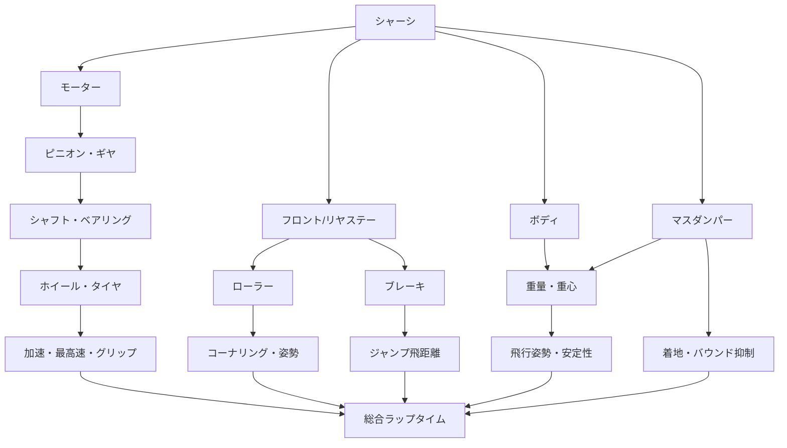

# ミニ四駆のカスタマイズ可能箇所と改造範囲：ストッククラス／オープンクラス調査報告

## エグゼクティブサマリー

本報告は**タミヤ製ミニ四駆を中心**とし、2026年10月26日時点で確認できるタミヤ公式規則を基準に、カスタマイズ可能な箇所を「ストッククラス」と「オープンクラス」に分けて整理したものです。基準とした最新版は、一般規則が「ミニ四駆公認競技会規則」（2026年1月5日追加・改訂）、ストッククラスが「ストッククラス・レギュレーション 2026年版2」（2026年5月11日改定、6月1日施行）です。ストッククラスは一般規則のうち「改造」の章だけを、より厳しい専用規定に置き換える構造になっています。citeturn1view0turn1view1

最も重要なのは、**タミヤ公式における「オープンクラス」は「何でもあり」の無制限クラスではない**という点です。公式イベントのオープンクラスは高校生以上を対象とする競技区分で、マシン自体は通常の「ミニ四駆公認競技会規則」に従います。自作シャーシ、非タミヤ製追加部品、不正改造モーター、ハンダ付けした電池受金具などはオープンクラスでも認められません。citeturn9view0turn1view1

また、依頼条件に例示された「ストックではモーター交換禁止」「ベアリングはオープンだけ」「オープンならローラー材質変更可能」という理解は、現行タミヤ規則とは異なります。

**ストッククラスでもダッシュ系モーター、ボールベアリング、カーボンプレート、ポリカーボネートボディ、マスダンパー、スライドダンパー等を使用できます。** タミヤはストックQ&Aでダッシュ系モーターを明示的に使用可とし、ボールベアリングとカーボンプレートも使用可としています。citeturn1view0

一方、ストックとオープンを大きく分けるのは、**パーツそのものの加工自由度**です。ストックではシャーシ切断・肉抜き、新規穴あけ、タイヤ切削、マスダンパー穴拡張、ローラーの構成変更等が禁止され、基本的には純正部品を「ポン付け」してセットアップします。通常規則ではシャーシの穴あけ・切断、部品の一定範囲の加工、タイヤ研削、ギヤの軽量加工などまで認められています。citeturn1view0turn1view1

したがって、実際の性能向上の方向性は次のように捉えると分かりやすくなります。

| 性能要素 | ストッククラスでの主な手段 | オープンクラスで追加される手段 |
|---|---|---|
| 速度 | モーター、ギヤ比、タイヤ径、駆動抵抗低減 | ギヤ加工、タイヤ加工、駆動系加工 |
| コーナリング | ローラー径・材質・位置、タイヤ材質、車幅 | プレート加工、より複雑なローラー機構 |
| ジャンプ | ブレーキ、マスダンパー、重量配分 | シャーシ加工、可動バンパー／高度な機構 |
| 着地 | タイヤ硬度、マスダンパー、低重心化 | フレキシブルシャーシ等の高度加工 |
| 重量 | ボディ肉抜き、軽量純正部品 | シャーシ／プレート等の追加加工 |
| 駆動効率 | ボールベアリング、グリス、適正組立 | ギヤ軽量化・ベアリング内蔵など |

タミヤ自身も、速さを単一パーツで決めるのではなく、モーター、ギヤ比、タイヤ径・グリップ、ベアリング、ローラー、ブレーキ、マスダンパー、重量／重心の組み合わせとして説明しています。特にモーターを高速化するとコースアウト率も増えるため、車体全体を同時にセッティングする必要があるとしています。citeturn4view0turn5view0

## 規則上の「ストック」と「オープン」の境界

### 共通する基本寸法

ストッククラスは専用規則に書かれていない部分について通常の公認競技会規則を使用するため、下記寸法は基本的に双方共通です。競技車は四輪駆動でなければならず、全幅105mm以下、全長165mm以下、全高70mm以下、最低地上高1mm以上、電池・モーター込みで最低90g、タイヤ径22～35mm・幅8～26mmです。ローラー数については2026年も特別ルールにより「制限なし」が継続されています。citeturn1view1

| 規制項目 | ストック | オープン＝通常公認規則 |
|---|---:|---:|
| 四輪駆動 | 必須 | 必須 |
| 最大幅 | 105mm | 105mm |
| 最大長 | 165mm | 165mm |
| 最大高 | 70mm | 70mm |
| 最低地上高 | 1mm | 1mm |
| 最低重量 | 90g | 90g |
| タイヤ径 | 22～35mm | 22～35mm |
| タイヤ幅 | 8～26mm | 8～26mm |
| ローラー数 | 2026年特別ルール：制限なし | 同左 |
| 自作シャーシ | × | × |
| 非タミヤ製追加部品 | × | × |

citeturn1view0turn1view1

### 比較表

| 改造対象 | ストッククラス | オープンクラス／通常規則 |
|---|---|---|
| **シャーシ切断・肉抜き** | **禁止** | **可能**。穴あけ・切断等の追加工作が認められる |
| シャーシ新規穴あけ | 禁止。既存穴の貫通・2mm拡張等はQ&Aで可 | 可能 |
| 皿ビス加工 | 既存穴等への加工は可 | 可 |
| FRP／カーボン切断 | 基本禁止。皿穴加工は可 | 元の輪郭を特定できる程度の切断等は可 |
| タイヤ切削 | **禁止** | **可能**。ただし規定寸法内・表面材質変更不可 |
| ホイール貫通 | 可 | 可 |
| ボディ肉抜き | 可 | 可 |
| ボディ分割 | 禁止 | ストックより加工自由度が高いが「ボディ」と確認できる状態が必要 |
| モーター交換 | **可** | 可 |
| ダッシュモーター | **可** | 可 |
| モーター巻線改造 | 禁止 | **禁止** |
| ギヤ比変更 | 指定組合せ内で可 | 指定組合せ内で可 |
| ギヤ軽量加工 | 禁止 | 穴あけ・削り等が可 |
| ギヤへのベアリング内蔵 | 禁止 | 可 |
| ボールベアリング | **可** | 可 |
| ローラー交換 | 可 | 可 |
| ローラーの異種合体・リング移植 | 禁止 | **通常規則でも禁止** |
| ローラーの上面穴あけ | 禁止 | 可と公式規則に例示 |
| マスダンパー | 可 | 可 |
| スライドダンパー | 可 | 可 |
| プレートを意図的にぐらつかせる | 禁止 | 通常規則ではストック専用の同一禁止条項はないが、全体規則・車検対象 |
| 電池受金具ハンダ付け | **禁止** | **禁止** |
| 電池受金具二枚重ね | **禁止** | **禁止** |
| タミヤ以外の追加部品 | 禁止 | **禁止** |
| 自作／3Dプリントシャーシ | 禁止 | **禁止** |

ストックで許される加工はかなり限定されており、タミヤは「シャーシの肉抜き・切断禁止」「ボディ以外の部品の形状変更禁止」を基本に、FRP／カーボン・シャーシ既存穴の皿加工とホイールのシャフト貫通を例外としています。通常規則では、シャーシの穴あけ・切断、原形を特定できる範囲の部品加工、タイヤ加工、ギヤの軽量化とベアリング内蔵まで認められます。citeturn1view0turn1view1

なお、通常規則でも「元の輪郭とは異なる形状までカーボン／FRP／金属部品を削り込むこと」「プラリングの移植」「異なる径のローラーの合体」「2段ローラーの上下切断」などは認められていません。「オープン＝ローラーを自由に旋盤加工できる」という意味ではありません。citeturn1view1

## 部位別カスタマイズ詳細

以下の難易度は本報告内での相対評価です。**★＝交換・ポン付け、★★＝位置調整を伴う、★★★＝精密調整、★★★★＝切削加工、★★★★★＝複数部品の高度な加工・機構設計**としています。

パーツの入手は、型番をタミヤ公式製品ページで確認したうえで、**タミヤ公式オンラインショップまたはミニ四駆ステーション**で在庫確認する方法が最も規則適合を判断しやすいです。タミヤは公式サイト上で全国のミニ四駆ステーションも案内しています。citeturn3search10turn4view0

| 部位 | 改造内容／セッティング | 目的・効果 | メリット／デメリット | ストック適合性 | パーツ例 | 難易度・主な工具 |
|---|---|---|---|---|---|---|
| **シャーシ** | シャーシ種類・材質違いへの交換、Aパーツ変更、既存穴利用、剛性調整 | 重心、重量、モーター位置、ホイールベース周辺特性、剛性を変える | ○マシン特性を根本から変えられる／△対応パーツが変わる | **○交換可**。Aパーツとの異なる組合せもQ&Aで可。ただし肉抜き・切断・新規穴は禁止 | FM-Aシャーシセット ITEM 95411など。2026年にはMEシャーシも公認規則へ追加 | ★～★★。ドライバー、ニッパー。オープン加工なら★★★★ |
| **モーター** | ノーマル→チューン系／ダッシュ系、トルク型・高速型を選択 | 加速・最高速を大きく変更 | ○最大効果が大きい／△高速化ほどCOリスク・消費電流増加 | **○**。ストックでもダッシュ系可。モーター分解部品はストック不可。不正巻線改造等は双方不可 | 15484 トルクチューン2、15477 ハイパーダッシュ3、PRO用15487等 | ★。基本工具不要／ピニオン交換時は専用工具が便利 |
| **ギヤ** | 3.5:1、3.7:1等へ変更 | 小さい比＝最高速、大きい比＝加速・登坂力寄り | ○コースに細かく合わせられる／△モーター・タイヤ径との組合せ依存 | **○指定組合せのみ**。ストックは削り不可。オープンは軽量加工・ベアリング内蔵可 | 15432 3.5:1、15434 3.7:1、15349 MS/MA/ME用3.5:1 | ★～★★。ドライバー、グリス。加工は★★★★ |
| **タイヤ・ホイール** | タイヤ硬度、径、幅、トレッド、前後で異なる種類、シャフト貫通 | グリップ、コーナー速度、加速、最高速、跳ねを調整 | ○効果が大きい／△ローグリップ化し過ぎると姿勢・駆動安定性が落ちる | **○交換可**。異サイズ組合せ可。**ストックでタイヤ削りは禁止**。ホイール貫通可 | 15534 ローフリクション26mm、15542 スーパーハード26mm | ★～★★。シャフト貫通は★★★・ピンバイス等 |
| **ローラー** | 直径9/13/17/19mm系、アルミ／プラリング等、前後高さ・幅・スラスト変更 | 壁面抵抗、コーナリング、LC安定性、姿勢制御 | ○最重要セット項目の一つ／△食いつきを増やすと抵抗も増える | **○交換可**。ストックでは製品本来の組合せ変更・ベアリング交換不可 | 15464 HG 19mmオールアルミ、15461 19mmプラリング付アルミ、15522 HG17mm | ★★～★★★。ドライバー、ナットドライバー、ゲージ |
| **バンパー・ステー** | FRP／カーボンを追加しローラー幅拡大、補強、ブレーキ基台化 | 全幅拡大、ローラー保持剛性、衝突耐久性 | ○105mm近くまで広げることで走行ラインを短くできる／△重量増・狭い旋回で負荷増 | **○ポン付け可**。皿穴可。ストックでは輪郭切削不可 | 15451 AR FRPフロントワイド、15430 FRPマルチワイドリヤ、15550 HGカーボンブレーキステー | ★★。ドライバー。皿穴加工は★★★ |
| **ブレーキ** | 前後ステーにスポンジ、厚み・摩擦力・高さ・面積調整 | スロープ進入速度とジャンプ飛距離を制御 | ○コースアウト抑制に非常に有効／△強すぎると大幅タイムロス | **○**。スポンジ切断可。最低地上高1mmを維持 | 15518 FRPリヤブレーキステー、15492 1/2/3mmブレーキスポンジ | ★★～★★★。ハサミ／カッター、ゲージ |
| **重心・ウェイト** | マスダンパーの重量・位置、重いパーツを下部・中央へ | 着地衝撃吸収、バウンド抑制、ジャンプ姿勢変更 | ○完走率上昇／△重量増で加速低下 | **○**。ストックではマスダンパー穴拡張不可 | 15478 ボールリンクマスダンパー、15515スクエアショート、15490 MAサイドマスダンパー | ★★。ドライバー、スペーサー調整 |
| **ボディ** | 樹脂→ポリカ、肉抜き、干渉部分カット、ウイング脱着 | 上部軽量化、低重心化、パーツ干渉回避 | ○上部軽量化は安定性に有利／△薄いポリカは破損・脱落に注意 | **○**。ストックは肉抜き・干渉カットのみ、分割不可。ボディキャッチ必須 | 15494 アスチュート・ポリカ、95406 ファイヤードラゴン・ポリカ等 | ★★～★★★。曲線ハサミ、カッター |
| **シャフト・ベアリング** | 車軸をボールベアリング化、カウンターギヤ軸受改善、精度の良いシャフトへ | 回転抵抗・ガタ低減 | ○速度・走行時間・再現性改善／△コスト増、汚れに敏感 | **○ストックでも使用可** | 15519 HG丸穴ボールベアリング、94389 AO-1011 620 | ★～★★。ピンセット、オイル／グリス |
| **電池** | アルカリ／ネオチャンプ選択、状態管理 | 電圧特性、重量、再利用性を変える | ○ネオチャンプは公認充電池／△大会ごとの指定に注意 | **○**。基本はタミヤ単3×2を市販状態で使用 | 15420 ネオチャンプ、55119 パワーチャンプRX、55117 RS | ★。充電池は対応充電器 |
| **電池端子・配線** | 純正ゴールドターミナル等への交換、接点清掃 | 接触抵抗・安定性改善 | ○簡単で再現性が高い／△対応シャーシ限定 | **△自由度は非常に低い**。ハンダ付け、二枚重ねは禁止。これはオープンも同様 | 15421 スーパーIIゴールドターミナル、15237 スーパーXゴールドターミナル | ★～★★。ドライバー、綿棒等 |
| **減衰・サスペンション** | マスダンパー、スライドダンパーによる衝撃・横荷重吸収 | 着地・壁接触時の姿勢安定 | ○コースアウト低減／△重量と機械的複雑さ増 | **マス／スライドは○**。シャーシ自体を切ってフレキ化する方式はストック× | 15478マスダンパー、95284/95285 スライドダンパー用カーボンステー等 | ★★～★★★。高度なオープン機構は★★★★★ |
| **空力／スタビライザー** | ボディ形状、ウイング、ハイマウントスタビ等 | 主に姿勢・フェンス乗り上げ抑制。ボディ形状変更は重量・重心にも影響 | ○姿勢制御の補助／△純粋な空力効果を公式資料から定量化することは困難 | ボディウイングを外すことはストックでも可。追加部品はタミヤ品に限る | 15528 ハイマウントチューブスタビ等 | ★～★★ |
| **耐久・安全** | キャップスクリュー、ロックナット、補強プレート、皿ビス化 | ローラー軸の曲がり、ナット緩み、ステー破損を減らす | ○レース中の脱落・変形を減らす／△若干重量増 | **○**。鋭利な形状やコースを傷つける構造は禁止 | 15454 2mmキャップスクリュー、15527皿ビス、15493ロックナット | ★★～★★★ |

### 速度系：モーター・ギヤ・タイヤ径はセットで考える

タミヤの公式セッティングガイドでは、モーターを「加速重視」「最高速重視」などで選択し、それをギヤ比とタイヤ／ホイール径で微調整する考え方を示しています。小径ホイール・薄いタイヤは加速寄り、大径側は最高速寄りになります。また3.5:1のような小さいギヤ比は速度側、5:1側はトルク・加速側です。citeturn4view0turn5view0

例えばITEM 15432は3.5:1の超速ギヤ、ITEM 15434は3.7:1のハイスピードEXで、後者は超速ギヤより加速力を確保しやすい位置付けです。MS・MA・2026年に追加されたME系ではITEM 15349の3.5:1超速ギヤなど、シャーシごとの適合確認が必要です。citeturn6search1turn6search5turn6search17

### タイヤは「グリップが高いほど速い」とは限らない

ミニ四駆ではコーナー内外輪の速度差を機械的なデフで吸収しないため、タイヤのグリップが高いほどコーナーで抵抗が増える側面があります。タミヤも、ソフトタイヤは安定側、ハード／ローグリップタイヤはコーナリング速度側という考え方を解説しています。トレッドを広げるほど内輪差による摩擦が増えて安定寄りになるとも説明しています。citeturn4view0

現行の具体例では、ITEM 15534「ローフリクション小径ローハイトタイヤ（26mm）＆カーボン強化ホイール」はスーパーハードよりさらに低グリップで、フロントのみ・片側のみ・リアのみといった配置による特性変化もタミヤ自身が案内しています。ITEM 15542のスーパーハード26mmは標準タイヤよりローグリップで、ジャンプ後も跳ねにくい性質を狙った製品です。citeturn6search3turn6search10

ストックではここを**「製品選択と前後左右の配置」で調整**し、オープンではさらにタイヤ径・幅・形状を削って合わせ込む、という違いになります。ストック規則はタイヤのカット・研削を明示的に禁止し、通常公認規則は寸法範囲内での形状変更を許可しています。citeturn1view0turn1view1

### ローラー・ステーはコーナリングの中核

タミヤはローラーについて、直径、厚み、重量、フェンスへの食いつきが走行を左右すると説明しています。また、車幅を105mmに近づけるほどコーナー内側を通って走行距離を短縮できる一方、旋回はよりタイトになるとしています。citeturn5view0

19mmオールアルミのITEM 15464は520ボールベアリング内蔵で高剛性・滑らかな回転を狙ったもの、19mmプラリング付ローラー等はフェンスとの摩擦特性が異なります。ストックでもこの「完成品ローラーの選択」は大きなセッティング項目です。citeturn7search0turn8search15

ただし、完成品ローラーを分解して別材質リングに換えたり、異径ローラー同士を合体したりする改造は**ストックだけでなく通常公認規則でも禁止例**に含まれています。ここは「オープンなら自由」ではありません。citeturn1view0turn1view1

### ブレーキとマスダンパーは立体コース用の二大調整項目

ブレーキはジャンプ直前の速度、マスダンパーは着地時の運動を主に調整します。タミヤはスポンジの摩擦、面積、高さによって飛距離を調整し、マスダンパーの重量と位置によって着地衝撃を制御する考え方を公式ガイドで説明しています。citeturn4view0

ITEM 15492には1・2・3mm厚のブレーキスポンジが用意され、シャーシ／ステー底面に貼ってスロープやジャンプ前の速度を抑えることを想定しています。ITEM 15478のボールリンクマスダンパーは8.3gで、低い位置への搭載による低重心化も意図されています。citeturn8search1turn7search1

ストッククラスでは**ブレーキスポンジを必要寸法にカットすること自体は認められています**。一方、マスダンパー穴拡張等は不可です。citeturn1view0

## オープンクラスで初めて可能になる加工

ここでは「ストックではできないが、通常のタミヤ公認競技会規則なら可能」という意味で「オープン専用」とします。ただし前述の通り、これは無制限改造を意味しません。

| 改造 | ストック | オープン／通常規則 | 具体的な狙い | 注意点 |
|---|---|---|---|---|
| **シャーシの切断・肉抜き** | × | ○ | 軽量化、剛性／しなり調整、機構スペース確保 | 自作シャーシは不可。寸法・重量・安全規則は継続 |
| **シャーシ新規穴あけ** | × | ○ | 独自パーツ位置、可動機構の支点作成 | ストックは既存穴の加工まで |
| **FRP／カーボンの切断加工** | × | ○条件付き | 重量・取付形状最適化 | 元の輪郭が特定できないほどの造形変更は不可 |
| **タイヤ研削／旋盤加工** | × | ○ | 真円度、径、幅、接地面調整 | 径22～35mm・幅8～26mm。表面材質変更不可 |
| **ギヤの穴あけ・削り** | × | ○ | 回転慣性・抵抗低減 | 指定ギヤ組合せは維持する |
| **ギヤへのベアリング内蔵** | × | ○ | カウンターギヤ等の抵抗低減 | タミヤ部品を使用 |
| **ローラー上面への穴あけ** | × | ○ | 軽量化等 | 通常規則が「特定できる加工」の例として明記 |
| **より大規模なボディ加工** | ×制限大 | ○条件付き | 軽量化、低重心化、機構との干渉回避 | 著しく小さく「ボディ」と判断できないものは不可となり得る |
| **シャーシ加工を伴うフレキ／サスペンション的機構** | × | ○の可能性 | 着地衝撃・ねじれ・路面追従を利用 | 規則に「MSフレキ」等の名称で包括認可されているわけではないため、最終的には車検判断 |
| **加工部品を用いた高度な可動バンパー機構** | ×または非常に制約大 | ○条件付き | フェンス衝突時の荷重逃がし、復帰性向上 | 部品原形、タミヤ部品、車体寸法、安全性を満たす必要 |

通常規則は、シャーシ加工を「穴あけや切断など原形に追加工作を施すもの」に限って認め、部品加工も元の輪郭を特定できる範囲で認めています。またギヤについては「軽量化のための穴あけや削り加工とベアリングの内蔵」、タイヤについては規定寸法内の形状変更を明示的に許可しています。citeturn1view1

この差から、いわゆる高度な加工車では、シャーシ側の切削と純正部品を組み合わせて着地衝撃を逃がす構造などを設計できる余地が生まれます。ただし、これは公式規則の加工許容範囲から導かれる**設計上の余地**であり、「○○方式なら必ず車検合格」という保証ではありません。規則に含まれない改造は主催者が参加可否を判断するとタミヤ自身が明記しています。citeturn1view1

### 「オープン専用」と誤解しやすいもの

| よくある理解 | 現行タミヤ規則での実態 |
|---|---|
| 「ストックはノーマルモーターだけ」 | **誤り。ダッシュ系も使用可** |
| 「ストックはベアリング禁止」 | **誤り。ボールベアリング使用可** |
| 「ストックはカーボン禁止」 | **誤り。カーボンプレート使用可** |
| 「オープンならモーター内部改造可」 | **誤り。不正改造は禁止** |
| 「オープンなら非タミヤ製ベアリング／パーツ自由」 | **誤り。追加部品はタミヤ製ミニ四駆・ラジ四駆・ダンガン用が原則** |
| 「オープンならローラーのリング移植・異種合体可」 | **誤り。通常規則でも禁止例** |
| 「オープンなら受金具をハンダ付けして低抵抗化できる」 | **誤り。通常規則でも禁止** |
| 「3Dプリンタで自作シャーシを作れる」 | **誤り。自作シャーシ禁止** |

citeturn1view0turn1view1

特にモーターについては、ME・MA・MSシャーシではキット付属ノーマルモーターと「ミニ四駆PRO専用モーター」各種、その他シャーシではノーマルに加えてトルクチューン2、レブチューン2、アトミックチューン2、ライトダッシュ、ハイパーダッシュ3、パワーダッシュ、スプリントダッシュ等が通常規則で使用可能です。ストックQ&Aもダッシュ系モーターを明確に認めています。citeturn1view1turn1view0

## パーツ構成図と実践的なセッティング順序

ミニ四駆は個々のパーツを独立して変更するより、**駆動系→接地系→案内系→姿勢制御系**という相互関係で考えるほうが合理的です。これはタミヤ公式ガイドが、モーター、ギヤ、タイヤ、ベアリング、ローラー、ブレーキ、マスダンパー、重量を相互に組み合わせて説明していることとも一致します。citeturn4view0turn5view0

ストッククラスでゼロから作る場合、加工技術より「部品選択と組立精度」が支配的になります。実用上は次の順序が失敗しにくいと考えられます。

**まず駆動を滑らかにする。** シャフト、軸受、ギヤを正しく組み、必要ならHG丸穴ベアリング等を導入します。タミヤも、軸受・ギヤ・ローラーの摩擦低減は最高速、加速、コーナリング速度、走行時間のすべてに寄与すると説明しています。グリスは多過ぎても抵抗になるため、適量が前提です。citeturn4view0turn2search10

**次にタイヤとローラーで「曲がれる車」にする。** モーターを先に極端に高速化しても、コーナーやジャンプでコースアウトすれば意味がありません。ローグリップ系タイヤ、17～19mmローラー、FRP／カーボンステーなどで安定性と旋回抵抗を調整します。citeturn4view0turn7search0

**その後ブレーキとマスダンパーを合わせる。** 立体コースではここが完走率を大きく左右します。ブレーキを必要最小限まで弱くしながらジャンプを収め、マスダンパーの重量と前後位置を詰める、という方向が速度と安定性のトレードオフを管理しやすい方法です。タミヤも「安全重視の強ブレーキ／重ダンパー」と「速度重視の弱ブレーキ／軽量ダンパー」の対比で説明しています。citeturn4view0

**最後にモーターとギヤで限界速度を上げる。** タミヤ自身、ノーマルから高速モーターへ換えるとコースアウト率が大幅に上がるため、車体全体の性能向上が必要としています。3.5:1・3.7:1等をコースの直線長、坂、車重、タイヤ径に合わせるのが基本です。citeturn4view0turn5view0

ストック車の一例を構成すると、**トルクチューン2またはハイパーダッシュ3＋HG丸穴ベアリング＋26mmスーパーハード／ローフリクションタイヤ＋FRPワイドステー＋17～19mmベアリングローラー＋ブレーキスポンジ＋必要量のマスダンパー**という構成は、すべて「純正パーツを加工せず組み合わせる」方向で高い調整幅を確保できます。各部品そのものがストック使用可能でも、最終的には105mm幅、90g以上、1mm以上の最低地上高その他の全体規則を同時に満たす必要があります。citeturn1view0turn1view1turn2search10turn6search10turn7search1turn8search1

## 工具・安全対策・規則確認の実務

ストッククラスなら、本格的な切削設備はほぼ必要ありません。基本はプラスドライバー、ニッパー、ナットを保持する工具、ピンセット、タイヤ／ローラー幅や地上高を見るゲージ類で対応できます。皿ビス加工を行う場合だけ専用の皿穴加工工具が加わります。タミヤのITEM 15527ステンレス皿ビスは、FRPプレート等に専用2mm皿穴加工ビットを使用することを案内しています。citeturn8search13

| 作業 | 推奨工具 | 難易度 | 主な失敗 |
|---|---|---:|---|
| モーター／ギヤ交換 | ドライバー、ピニオン用工具 | ★ | ギヤ組合せ間違い、グリス過多 |
| ベアリング交換 | ピンセット、クリーニング用品 | ★ | 斜め挿入、汚れ混入 |
| ローラー／ステー調整 | ドライバー、ナット工具、セッティングゲージ | ★★ | 左右非対称、105mm超過 |
| ブレーキ | カッター／ハサミ、地上高ゲージ | ★★ | 1mm未満、効き過ぎ、剥離 |
| ボディ肉抜き | ニッパー、曲線ハサミ、ヤスリ | ★★★ | 割れ、切り過ぎ |
| 皿穴加工 | 皿穴ビット | ★★★ | 深過ぎ、穴位置損傷 |
| タイヤ研削（オープン） | タイヤ加工工具、ノギス | ★★★★ | 22mm未満、左右径差 |
| シャーシ切削（オープン） | ニッパー、ヤスリ、ドリル等 | ★★★★ | 強度低下、寸法逸脱 |
| フレキ／複雑可動機構 | 上記＋精密測定具 | ★★★★★ | ガタ、駆動ロス、車検不適合 |

耐久性では、ローラーポストや重いマスダンパー部分に強度の高いビスを使う効果が大きく、ITEM 15454の2mmキャップスクリューは、タミヤが通常のステンレスビスより約1.5倍の曲げ強度を持つと説明しています。コースアウト時に曲がりにくく、ローラーや重量物の取り付け向けです。citeturn8search2

また、ストック規則・通常規則ともに、手やコースを傷つける形状、グリスが飛散してコースを汚す構造は禁止されています。電池は基本的にタミヤ単3形2本を市販状態で使用し、ラベルが破損したものは安全上使用できません。大会によって使用電池の追加指定・例外があるため、レース当日の募集要項が公認規則に優先する場合があります。citeturn1view0turn1view1

タミヤ主催イベントでは会場への充電器、モーターならし器、モーターチェッカー、バッテリーウォーマー、引火性スプレー等の持ち込みを禁止する場合もあります。したがって、競技用セッティングでは「家でできる作業」と「会場へ持ち込めるもの」を分けて考える必要があります。citeturn0search12

空力については注意が必要です。タミヤ公式のセッティングガイドは、性能調整要素としてモーター、ギヤ、タイヤ、回転抵抗、ブレーキ、マスダンパー、重量／重心、ローラーを詳しく扱う一方、ウイング角等の空力調整を独立した主要項目としては扱っていません。したがってレース用ミニ四駆では、空力パーツを優先するより、**上部重量・重心、ローラー姿勢、ブレーキ、タイヤ、着地制御を先に最適化する方が、公式資料で裏付けられたセッティング手順**です。citeturn4view0turn5view0

最後に車検基準を整理すると、ストックでは「加工して速くする」のではなく、**許可された完成部品の選択、取付位置、前後左右の組合せ、重量配分、摩擦、ギヤ比、モーター特性を使って速くする**のが本質です。一方オープンでは、その上に切削・穴あけ・タイヤ加工・ギヤ加工・複雑な機構設計が加わります。それでもタミヤ製部品、自作シャーシ禁止、規定寸法、不正モーター禁止、電装改造禁止、安全性という外枠は残ります。citeturn1view0turn1view1

**参照基準日：2026年10月26日（日本時間）**。ストッククラスは「2026年版2・2026年5月11日改定／6月1日施行」、一般公認競技会規則は2026年1月5日付の追加・改訂を確認しました。タミヤは個別大会で特殊条件を設定する場合があると明記しているため、実際に出場する際にはこの一般規則だけでなく、当該大会の募集要項・特別ルールまでを最終基準とする必要があります。citeturn1view0turn1view1turn0search4